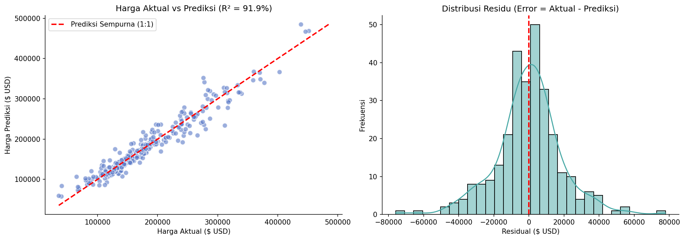

# 🏠 Ames House Price Prediction — Advanced Regression & Ensembling

End-to-end Machine Learning project untuk memprediksi harga jual properti perumahan (*SalePrice*) menggunakan regresi ber-regularisasi, gradient tree boosting, dan teknik *blending ensemble*, dilengkapi analisis residu komprehensif serta aplikasi web interaktif berbasis Streamlit.

[](https://www.python.org/)
[](https://scikit-learn.org/)
[](https://xgboost.readthedocs.io/)
[](https://streamlit.io/)

---

## 📌 Ringkasan Proyek

Penentuan harga wajar properti merupakan tantangan kompleks di industri real estate karena melibatkan puluhan faktor heterogen: luas tanah, kualitas material bangunan, fasilitas interior/eksterior, hingga kondisi pasar saat transaksi.

Proyek ini menggunakan dataset **Ames Housing (Kaggle: House Prices - Advanced Regression Techniques)** yang mencakup 79 karakteristik fisik rumah di Ames, Iowa. Pendekatan yang diterapkan mencakup penanganan skewness target, pembersihan outlier ekstrem, *domain-driven feature engineering*, dan penggabungan model linear (*Ridge*) dengan model non-linear (*XGBoost*).

### 🏆 Highlight Hasil Akhir (Holdout Test Set — 292 Rumah):
- **Model Final:** **Ensemble Blending (60% Ridge Regression + 40% XGBoost Regressor)**
- **Log-RMSE (Metrik Resmi Kaggle):** **`0,1169`** (Setara dengan peringkat Top 10–15% pada kompetisi Kaggle)
- **$R^2$ Score (Koefisien Determinasi):** **`91,89%`** variasi harga berhasil dijelaskan secara akurat
- **Mean Absolute Error (MAE):** **`$13.485,69`**
- **Median Absolute Error:** **`$9.190,08`** (pada 50% data uji, deviasi prediksi berada di bawah $9.200)

---

## 📊 Temuan Kunci EDA & Analisis Data

1. **Distribusi Target & Skewness:**
   - Distribusi harga jual asli mengalami *right-skewed* berat (kemencengan **1,88**).
   - Menerapkan transformasi $\log(1 + y)$ (`np.log1p`) berhasil menormalkan target ke skewness **0,12** (hampir simetris sempurna), menstabilkan varians error regresi.
2. **Pola Nilai Kosong (Informative Missingness):**
   - Kolom fasilitas seperti `PoolQC` (99,5%), `MiscFeature` (96,3%), `Alley` (93,8%), `Fence` (80,8%), dan `FireplaceQu` (47,3%) bernilai `NaN` karena properti terkait **memang tidak memiliki fasilitas tersebut**.
   - Kolom-kolom ini diimputasi dengan label eksplisit `"None"` daripada dihapus.
3. **Deteksi Outlier Ekstrem:**
   - Ditemukan 2 observasi anomali pada `GrLivArea > 4000 sq ft` dengan harga jual `< $300.000` (penjualan parsial abnormal non-pasar). Kedua outlier ini dihapus untuk mencegah distorsi garis regresi.

---

## 🛠️ Feature Engineering Berbasis Real Estate

Beberapa fitur sintetis baru diciptakan untuk merepresentasikan nilai guna properti:
- **`TotalSF`** = `TotalBsmtSF` + `1stFlrSF` + `2ndFlrSF` (Total luas huni seluruh lantai). Fitur ini melonjakkan korelasi terhadap log-harga menjadi **`0,8277`** (mengungguli fitur tunggal terkuat sebelumnya).
- **`TotalBath`** = `FullBath` + $0.5 \times$ `HalfBath` + `BsmtFullBath` + $0.5 \times$ `BsmtHalfBath`.
- **`HouseAge`** = `YrSold` - `YearBuilt` (Usia bangunan saat transaksi).
- **`RemodAge`** = `YrSold` - `YearRemodAdd` (Waktu sejak renovasi terakhir).
- **Fitur Fasilitas Biner:** `HasPool`, `HasGarage`, `HasBasement`, `HasFireplace`.

---

## ⚙️ Evaluasi & Perbandingan Model (5-Fold Cross-Validation)

Seluruh prapemrosesan (imputasi median/kategori dan One-Hot Encoding) dibungkus dalam `ColumnTransformer` scikit-learn dan dipelajari hanya dari data latih pada masing-masing fold untuk mencegah *data leakage*.

| Arsitektur Model | 5-Fold CV Log-RMSE | Rata-rata Error MAE ($) | $R^2$ Score | Karakteristik Performa |
| :--- | :---: | :---: | :---: | :--- |
| **Dummy Regressor (Baseline)** | 0,3972 | $55.316,19 | -0,0108 | Prediksi median sederhana |
| **Random Forest Regressor** | 0,1354 | $17.074,57 | 88,28% | Ensemble pohon bagging |
| **Gradient Boosting** | 0,1207 | $14.821,27 | 90,68% | Boosting bertahap |
| **XGBoost (Setelah Tuning)** | 0,1194 | $14.650,22 | 90,92% | Kuat menangkap interaksi non-linear |
| **Ridge Regression (Tuned $\alpha=10$)** | 0,1122 | $13.466,21 | 91,88% | Sangat stabil pada data sparse one-hot |
| **Ensemble Blended (Ridge 60% + XGB 40%)** | **`0,1097`** 🏆 | **`$12.968,03`** 🏆 | **`92,24%`** 🏆 | **Model Terbaik!** Menggabungkan keunggulan linear & non-linear |

---

## 📈 Evaluasi Holdout Test Set & Analisis Residu

Model final dievaluasi pada 292 rumah data uji independen:



- **Plot Prediksi vs Aktual (Kiri):** Sebaran titik berada sangat dekat dengan garis diagonal merah 1:1 ($R^2 = 91,9\%$).
- **Plot Distribusi Residu (Kanan):** Selisih error ($y_{\text{aktual}} - y_{\text{prediksi}}$) terdistribusi normal Gaussian simetris di sekitar angka 0 tanpa adanya heteroskedastisitas sistematis.

---

## 🚀 Menjalankan Aplikasi Web (Streamlit)

Aplikasi kalkulator nilai wajar properti interaktif memungkinkan estimasi harga secara real-time dengan interval keyakinan wajar (confidence interval).

```bash
# 1. Clone repositori
git clone https://github.com/rafikamindra98/house-price-prediction.git
cd house-price-prediction

# 2. Buat virtual environment
python -m venv .venv
source .venv/bin/activate  # macOS/Linux
# atau di Windows PowerShell: .venv\Scripts\Activate.ps1

# 3. Pasang dependensi & jalankan aplikasi
pip install -r requirements.txt
streamlit run app.py
```

Buka peramban pada `http://localhost:8501`.

---

## 📁 Struktur Repositori

```text
house-price-prediction/
├── app.py                         # Aplikasi kalkulator harga Streamlit
├── house_price_artifacts/         # Model terlatih & artefak evaluasi
│   ├── house_price_model.joblib   # Pipeline Ridge + XGBoost + bobot blending
│   ├── feature_defaults.json      # Template nilai dasar fitur
│   ├── metadata.json              # Rekaman parameter & versi dependensi
│   ├── test_evaluation_plots.png  # Grafik evaluasi residu
│   └── test_results.csv           # Rekap metrik data uji
├── data/
│   └── README.md                  # Petunjuk dataset sumber (Ames Housing)
├── notebooks/
│   └── 02_house_price_prediction.ipynb # Notebook lengkap eksperimen
├── reports/figures/
│   └── test_evaluation_plots.png
├── requirements.txt               # Dependensi runtime Streamlit
├── requirements-notebook.txt      # Dependensi analisis notebook
├── .gitignore
└── README.md
```

---

## 👤 Penulis
**Rafi Kamindra**  
- GitHub: [@rafikamindra98](https://github.com/rafikamindra98)
